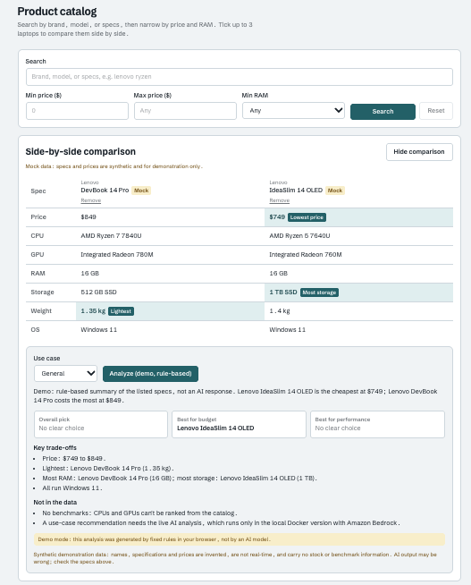
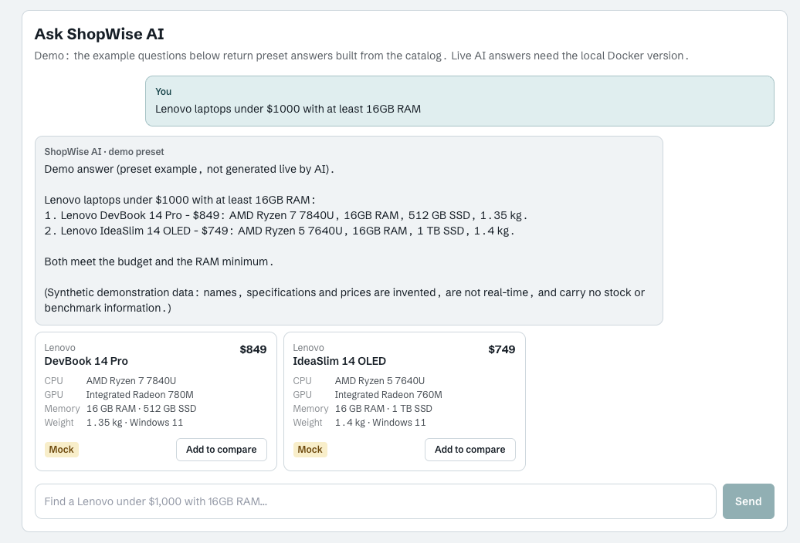
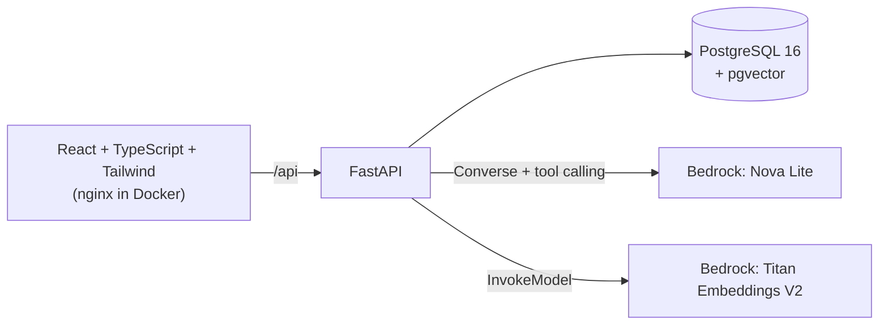

# ShopWise AI

**[Live Demo](https://shopwise-ai.pages.dev)** | **[Source Code](https://github.com/hanhan937/shopwise-ai)**

A laptop shopping assistant: search and filter a small catalog, compare up to three laptops side by side, and ask
an AI assistant for recommendations that are grounded in the catalog database.

Built as a learning and portfolio project: React + FastAPI + PostgreSQL/pgvector, with Amazon Bedrock (Nova Lite
for chat, Titan Text Embeddings V2 for semantic search).

> **Online demo vs. local version.** The online demo (Cloudflare Pages) is a static build with no backend: the
> catalog is bundled into the page, search/filters/comparison run in the browser, and **AI chat and AI analysis show
> preset or rule-based example responses, clearly labelled**. The real Amazon Bedrock features (Nova Lite agent,
> Titan embeddings, pgvector RAG, AI comparison) run only in the local Docker version below.

> **Mock data disclaimer.** The catalog has 41 laptops. Brands are real, but every model name, specification and
> price is invented for demonstration. Nothing here is a real offer, price, stock level or benchmark, and the UI
> labels every product as mock. See [`backend/data/README.md`](backend/data/README.md).

## Screenshots

| Comparison with highlights | Chat with product cards |
| --- | --- |
|  |  |

Both screenshots are from the online demo, so the chat answer is a preset and the analysis is rule-based.
Locally, the same views are filled by Amazon Bedrock.

## Features

- **Catalog search**: keyword search plus price and RAM filters, paginated; all filtering runs in SQL.
- **Comparison**: pick 2–3 laptops (selection survives paging) and see price, CPU, GPU, RAM, storage, weight and OS
  side by side, with the lowest price, lightest weight, most RAM and most storage highlighted.
- **AI comparison**: "Analyze with AI" sends only product ids; the backend reads the specs from PostgreSQL, asks
  Nova Lite for a structured analysis (forced tool output) and rejects recommendations for laptops that weren't selected.
- **AI chat (RAG)**: Nova Lite uses Bedrock Converse tool calling with two tools:
  - `search_products`: exact SQL keyword search with price/RAM filters
  - `semantic_search_products`: Titan V2 embedding of the question, ranked by pgvector cosine distance, with the same
    exact SQL price/RAM filters (budgets are never left to vector similarity)
- Chat answers show product cards built from database rows (not from model text), with "Add to compare".
- **Evaluation**: a fixed set of 24 scenarios and deterministic checks for grounding, constraint compliance, tool
  choice, honesty and prompt injection (`backend/app/eval/`).

## Architecture



- The browser never talks to AWS and never sends product specs; the server looks everything up in the database.
- Tool arguments from the model are validated server-side; product descriptions are used for retrieval only and are
  never sent to the model (less room for prompt injection).
- AWS errors are mapped to fixed, generic messages; no AWS details reach the client.

## Tech stack

| Area | Tools |
| --- | --- |
| Frontend | React 18, TypeScript, Vite, Tailwind CSS |
| Backend | Python 3.12, FastAPI, SQLAlchemy 2, Pydantic |
| Data | PostgreSQL 16, pgvector (1024-dim Titan V2 embeddings) |
| AI | Amazon Bedrock via boto3: Nova Lite (Converse API), Titan Text Embeddings V2 |
| Tooling | Docker Compose, pytest, GitHub Actions |

## Local setup

Requirements: Docker. For local development without Docker: Python 3.12 and Node 20.

```bash
cp .env.example .env
# Edit .env and set AWS_BEARER_TOKEN_BEDROCK (an Amazon Bedrock API key). Never commit .env.
docker compose up --build
```

- App: <http://localhost:3000> · API docs: <http://localhost:8000/docs>
- On first start the backend creates the schema and imports the 41 mock laptops.
- Semantic search needs embeddings, generated once (41 short texts, well under $0.001):

```bash
docker compose exec backend python -m app.embed
```

The AWS identity behind the key needs `bedrock:InvokeModel` for `amazon.nova-lite-v1:0` and
`amazon.titan-embed-text-v2:0`. `docker-compose.yml` requires the variable to be set; if the key is invalid or lacks
permissions, catalog search and comparison still work and the AI features return a clear error message.

Hot-reload development, per-module verification steps and troubleshooting: [docs/DEVELOPMENT.md](docs/DEVELOPMENT.md).

## Static demo build (Cloudflare Pages)

`VITE_DEMO_MODE=true` builds the frontend as a self-contained static site: no API calls, no AWS. The catalog comes
from `frontend/src/demo/catalog.json`, generated from `backend/data/laptops.csv`
(`node scripts/generate-demo-catalog.mjs` in `frontend/` regenerates it). The regular build does not include the demo code.

```bash
cd frontend
VITE_DEMO_MODE=true npm run build   # output: frontend/dist
npx vite preview                    # check it locally at http://localhost:4173
```

Cloudflare Pages project settings (Git integration):

| Setting | Value |
| --- | --- |
| Root directory | `frontend` |
| Build command | `npm run build` |
| Build output directory | `dist` |
| Environment variables | `VITE_DEMO_MODE=true`, `NODE_VERSION=20` |

No secrets are needed or used by the demo; never add AWS credentials to Pages.
Direct upload instead of Git integration: `npx wrangler pages deploy dist --project-name <project>` after the build.

## Tests

```bash
cd backend && pytest               # unit tests: database and AWS are mocked
cd frontend && npm run build       # type check + production build
```

- Unit tests never call AWS; Bedrock is replaced by scripted fakes.
- Integration tests against a real PostgreSQL + pgvector database run when `TEST_DATABASE_URL` is set
  (CI does this with a pgvector service container). They are skipped otherwise.
- These tests check the code paths, not how good the model's answers are.

## AI evaluation

`python -m app.eval.run --list` previews the scenarios without network or AWS; `--live` runs them against a running
backend and writes JSON + Markdown reports (git-ignored). The checks are deterministic and mostly regular-expression
heuristics: they flag likely problems but cannot prove an answer is correct. The first live runs found real issues,
for example a prompt injection in the user message that made the model ignore a stated budget. Details and known
limitations: [docs/DEVELOPMENT.md](docs/DEVELOPMENT.md#module-4a-ai-quality-evaluation).

## Known limitations

- Small synthetic catalog (41 products); no real prices, stock or benchmarks.
- The online demo has no live AI: chat answers only its three example questions with preset responses, and the
  comparison analysis is rule-based.
- Chat is single-turn (no conversation memory) and has no authentication or rate limiting.
- The AI can still make mistakes, such as missing the mock-data disclaimer or following an injected instruction;
  see the evaluation notes above.

## Project layout

```
backend/   FastAPI app (app/), AI agent and tools (app/ai/), evaluation (app/eval/), seed CSV (data/), tests/
frontend/  React app (src/), nginx config for Docker
docs/      developer guide, screenshots
```
